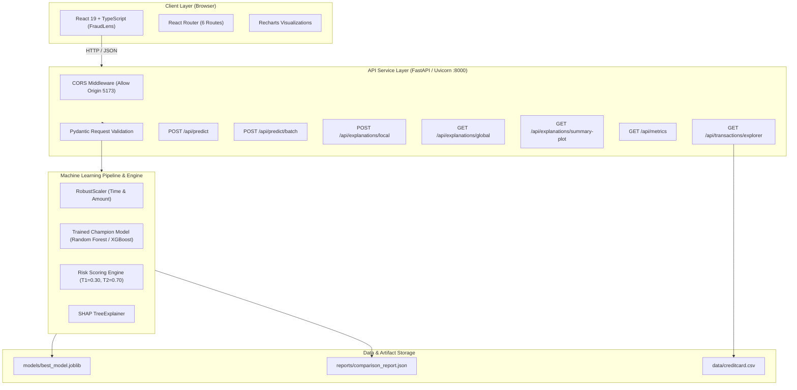

# Fraud Detection & Risk Assessment System Using Machine Learning

A production-grade, full-stack Machine Learning system for real-time credit card fraud probability estimation, explainable AI risk scoring, and high-throughput batch evaluation on severely imbalanced transaction streams.

---

## 1. Executive Summary & Core Capabilities

Financial credit card fraud constitutes a severe class-imbalance problem: fraudulent transactions account for fewer than 0.18% of all operations. Naive machine learning models optimizing for standard accuracy fail catastrophically by classifying every transaction as legitimate (achieving 99.82% accuracy while detecting 0% of fraud).

This system addresses the challenge through a production-grade decoupled architecture:
- **FastAPI Async Backend Service**: High-concurrency inference engine providing single-transaction prediction, high-throughput CSV batch evaluation, SHAP explainability endpoints, and transaction exploration APIs.
- **Modern React + TypeScript Frontend (FraudLens)**: Institutional-grade fintech dashboard built with Vite, Tailwind CSS, Lucide icons, and Recharts, offering real-time risk gauges, interactive SHAP waterfall attributions, custom threshold tuning, and accessible WCAG 2.1 AA UI components.
- **Machine Learning Core**: Leakage-free preprocessing (`RobustScaler`), class-imbalance mitigation, calibrated probability estimation, and a 3-tier risk policy engine mapping raw model probabilities to business action tiers (Approved, Step-Up Verification, Decline).
- **Explainable AI (SHAP)**: Fast TreeExplainer local feature attributions and global beeswarm importance visualizations explaining exact risk drivers.

---

## 2. System Architecture & Data Flow



### Data Flow Lifecycle:
1. **Request Ingestion**: Client submits transaction features (`Time`, `Amount`, `V1`–`V28`) to `/api/predict`.
2. **Schema Validation**: Pydantic validates data types, non-null constraints, and finite numerical values.
3. **Pipeline Transformation**: `RobustScaler` scales `Time` and `Amount` using pre-fitted median and IQR parameters; PCA features (`V1`–`V28`) pass through without leakage.
4. **Model Inference**: Serialized champion pipeline outputs calibrated fraud probability $P(\text{Fraud})$.
5. **Risk Assessment**: `RiskEngine` computes a $0\text{--}100$ score and categorizes into Low ($<0.30$), Medium ($0.30\le P < 0.70$), or High Risk ($\ge 0.70$).
6. **Local Explainability**: `SHAP TreeExplainer` computes exact local feature contributions ($\phi_i$) indicating why the transaction was flagged.
7. **Telemetry & Response**: JSON payload returned to React UI for rendering in telemetry meters and waterfall charts.

---

## 3. Technology Stack

### Backend & Machine Learning
- **Python**: 3.13.1
- **API Framework**: FastAPI 0.135+, Uvicorn 0.43+
- **Data & ML**: Scikit-Learn 1.8+, XGBoost 3.2+, Imbalanced-Learn 0.14+, Pandas 2.3+, NumPy 2.4+
- **Explainability**: SHAP 0.51+, Matplotlib 3.10+ (Agg backend)
- **Serialization**: Joblib 1.5+
- **Validation**: Pydantic v2
- **Testing**: Pytest 9.1+, Starlette TestClient, AnyIO

### Frontend & Dashboard
- **Runtime & Tooling**: Node.js v24+, Vite 8.3+, TypeScript 5.9+
- **UI Library**: React 19, React Router DOM 7.5+
- **Styling**: Tailwind CSS v4, Lucide React icons
- **Charts**: Recharts 2.15+
- **Linting**: Oxlint

---

## 4. Repository Structure

```
Fraud_Detection/
├── backend/                        # Production FastAPI Service
│   ├── app/
│   │   ├── __init__.py
│   │   ├── main.py                 # FastAPI application & route declarations
│   │   └── schemas.py              # Pydantic request/response schemas
│   └── tests/
│       ├── test_api.py             # 20 automated integration & contract tests
│       └── __init__.py
├── frontend/                       # Institutional React + TypeScript Website
│   ├── src/
│   │   ├── components/             # Reusable UI components (Navbar, Footer, etc.)
│   │   ├── pages/                  # 6 Core Application Routes + 404
│   │   │   ├── Overview.tsx        # System KPIs, status, and benchmark charts
│   │   │   ├── Analyze.tsx         # Single transaction scoring & SHAP waterfall
│   │   │   ├── BatchAnalysis.tsx   # CSV upload, batch processing, & export
│   │   │   ├── Transactions.tsx    # Transaction audit explorer & filter modal
│   │   │   ├── ModelInsights.tsx   # Model comparison table & SHAP plot
│   │   │   ├── About.tsx           # Model card & regulatory compliance
│   │   │   └── NotFound.tsx        # Fallback 404 route
│   │   ├── services/
│   │   │   └── api.ts              # Typed API client with custom error handling
│   │   ├── types/
│   │   │   └── index.ts            # TypeScript interfaces & API contracts
│   │   ├── App.tsx                 # Main layout & router definition
│   │   └── main.tsx                # Client entry point
│   ├── package.json
│   ├── tsconfig.json
│   └── vite.config.ts
├── data/
│   ├── creditcard.csv              # Primary ULB dataset (ignored in git)
│   ├── sample_batch.csv            # Sample test batch for validation
│   └── README.md
├── models/
│   ├── best_model.joblib           # Serialized Champion Model Pipeline
│   └── .gitkeep
├── reports/
│   ├── comparison_report.json      # Verified metrics across all candidate models
│   ├── baseline_report.json        # Baseline Logistic Regression evaluation
│   ├── pr_curve_comparison.png     # Precision-Recall curve comparison artifact
│   └── confusion_matrix_*.png      # Confusion matrix plots
├── src/                            # Machine Learning & Inference Core
│   ├── config.py                   # Centralized configuration & directory paths
│   ├── data_validation.py          # Dataset schema and integrity verification
│   ├── preprocessing.py            # Leakage-free preprocessing pipeline
│   ├── train.py                    # Stratified training routines
│   ├── evaluate.py                 # Imbalance-aware evaluation protocols
│   ├── predict.py                  # Production inference predictor
│   ├── risk_engine.py              # Calibrated risk scoring engine
│   └── explainability.py           # SHAP TreeExplainer & waterfall generator
├── tests/                          # Root Pytest Suite (ML Pipeline & Core)
│   ├── test_config.py
│   ├── test_data_validation.py
│   ├── test_preprocessing.py
│   ├── test_train_evaluate.py
│   ├── test_risk_engine.py
│   ├── test_predictions.py
│   └── test_explainability.py
├── requirements.txt                # Python dependencies
├── PROJECT_PROGRESS.md             # Authoritative phase milestone tracking
└── README.md                       # Comprehensive system documentation
```

---

## 5. Dataset & Target Variable

The system is trained and evaluated on the **ULB Machine Learning Group Credit Card Fraud Detection** benchmark dataset:
- **Total Transactions**: 284,807 transactions recorded over a two-day period in September 2013 by European cardholders.
- **Target Variable**: `Class` (Binary classification: `0` = Legitimate, `1` = Fraudulent).
- **Class Distribution**:
  - Legitimate (`Class = 0`): 284,315 transactions (99.8273%)
  - Fraudulent (`Class = 1`): 492 transactions (0.1727%)
  - Imbalance Ratio: **577.88 : 1**
- **Features**:
  - `Time`: Elapsed seconds between this transaction and the first transaction in the dataset.
  - `Amount`: Transaction amount in Euros (EUR).
  - `V1`–`V28`: 28 numerical principal components obtained via PCA to protect confidential cardholder identities.

---

## 6. Setup & Installation Guide

### Prerequisites
- **Python**: 3.10+ (Verified on 3.13.1)
- **Node.js**: 20.0+ (Verified on 24.17.0)
- **Git**: 2.20+

### Step 1: Clone Repository
```bash
git clone <repository-url>
cd Fraud_Detection
```

### Step 2: Configure Python Virtual Environment & Install Dependencies
```bash
# Windows (PowerShell):
python -m venv .venv
.\.venv\Scripts\Activate.ps1

# macOS / Linux:
python3 -m venv .venv
source .venv/bin/activate

# Upgrade pip & install backend dependencies:
pip install --upgrade pip
pip install -r requirements.txt
```

### Step 3: Install Frontend Dependencies
```bash
cd frontend
npm install
cd ..
```

### Step 4: Environment Variables Configuration
The frontend connects to the backend through `VITE_API_BASE_URL`.
- A template file exists at `frontend/.env.example`.
- Create a local configuration:
```bash
# In frontend/.env:
VITE_API_BASE_URL=http://localhost:8000
```
If omitted, the frontend automatically defaults to `http://localhost:8000`.

---

## 7. Running the System

### Option A: Run Backend Service (FastAPI)
From the repository root:
```bash
# Start FastAPI with Uvicorn auto-reload:
.\.venv\Scripts\python.exe -m uvicorn backend.app.main:app --host 127.0.0.1 --port 8000 --reload
```
- Interactive Swagger UI: `http://127.0.0.1:8000/docs`
- ReDoc Documentation: `http://127.0.0.1:8000/redoc`
- Health Endpoint: `http://127.0.0.1:8000/api/health`

### Option B: Run Frontend Dashboard (Vite)
In a separate terminal:
```bash
cd frontend
npm run dev
```
- Open your browser at: `http://127.0.0.1:5173`

---

## 8. Available API Endpoints & Request Contracts

| Method | Endpoint | Description |
|---|---|---|
| `GET` | `/api/health` | Service health status, model load status, and version |
| `GET` | `/api/model-info` | Metadata, champion model class, feature schema, and thresholds |
| `GET` | `/api/metrics` | Model comparison metrics (PR-AUC, ROC-AUC, Recall, Precision, F1) |
| `POST` | `/api/predict` | Single transaction fraud prediction and risk score assessment |
| `POST` | `/api/predict/batch` | High-throughput CSV file batch scoring and summary statistics |
| `GET` | `/api/sample-batch` | Download valid sample CSV with legitimate and fraud rows |
| `POST` | `/api/explanations/local` | SHAP local feature attribution waterfall values |
| `GET` | `/api/explanations/global` | Top 30 globally ranked SHAP feature importance values |
| `GET` | `/api/explanations/summary-plot` | Precomputed global SHAP beeswarm summary plot (PNG image stream) |
| `GET` | `/api/transactions/explorer` | Filterable evaluation dataset rows for auditing |

### Example 1: Single Prediction (`POST /api/predict`)

**Request Payload:**
```json
{
  "features": {
    "Time": 406.0,
    "Amount": 1.0,
    "V1": -2.31,
    "V2": 1.95,
    "V3": -1.61,
    "V4": 3.99,
    "V5": -0.52,
    "V6": -1.43,
    "V7": -2.54,
    "V8": 1.39,
    "V9": -2.77,
    "V10": -2.77,
    "V11": 3.20,
    "V12": -2.90,
    "V13": -0.60,
    "V14": -4.29,
    "V15": 0.39,
    "V16": -1.14,
    "V17": -2.83,
    "V18": -0.01,
    "V19": 0.42,
    "V20": 0.13,
    "V21": 0.52,
    "V22": -0.04,
    "V23": -0.47,
    "V24": 0.32,
    "V25": 0.04,
    "V26": 0.18,
    "V27": 0.26,
    "V28": -0.14
  },
  "low_threshold": 0.30,
  "high_threshold": 0.70
}
```

**Response Payload (200 OK):**
```json
{
  "fraud_probability": 0.9946,
  "risk_score": 99,
  "risk_category": "High Risk",
  "operational_recommendation": "Immediate Interception: Severe fraud risk. Hold/decline transaction and alert cardholder.",
  "model_name": "RandomForestClassifier",
  "threshold_configuration": {
    "low_threshold": 0.3,
    "high_threshold": 0.7
  },
  "transaction_summary": {
    "amount": 1.0,
    "time": 406.0
  }
}
```

---

## 9. Machine Learning Evaluation & Model Benchmark

Models were trained on an 80% stratified training partition (227,845 rows, 394 frauds) and evaluated on an isolated 20% holdout test partition (56,962 rows, 98 frauds) with zero data leakage:

| Model Architecture | PR-AUC (Primary) | Recall | Precision | F1-Score | ROC-AUC | False Positives |
|---|---|---|---|---|---|---|
| **Random Forest (Balanced Champion)** | **0.8541** | **0.8469** | **0.7281** | **0.7830** | **0.9702** | **31** |
| XGBoost (scale_pos_weight) | 0.8415 | 0.8163 | 0.8889 | 0.8511 | 0.9790 | 10 |
| Baseline Logistic Regression (Balanced) | 0.7175 | 0.9184 | 0.0609 | 0.1142 | 0.9720 | 1,388 |
| Logistic Regression + SMOTE | 0.7251 | 0.9184 | 0.0628 | 0.1176 | 0.9744 | 1,342 |

### Why Random Forest is the Champion Model:
While baseline Logistic Regression captures 90/98 frauds (91.8% recall), it produces **1,388 false positives** (precision of only 6.09%), causing massive operational alert fatigue. Random Forest achieves **84.69% recall with only 31 false positives** (72.81% precision), reducing false alarms by **97.7%** and achieving the highest holdout **PR-AUC of 0.8541**.

---

## 10. Automated Testing & Verification Results

### Backend Test Suite (Pytest)
```bash
.\.venv\Scripts\python.exe -m pytest tests backend/tests -v
```
**Results**:
- **79 of 79 tests PASSED** in 16.76s (100% pass rate).
- Tests cover: configuration paths, data validation & schema checking, leakage-free preprocessing, train/eval pipelines, risk threshold boundaries, predictions engine, SHAP attribution math, FastAPI endpoints, CORS preflight, CSV batch uploading, and error handling.

### Frontend Quality Checks (TypeScript & Linter)
```bash
cd frontend
npm run lint
npm run build
```
**Results**:
- **Oxlint**: 0 errors across 18 source files.
- **TypeScript Compiler (`tsc -b`)**: 0 errors.
- **Vite Production Bundle**: Successfully built in 3.20s (`dist/assets/index-*.js`, `dist/assets/index-*.css`).

### End-to-End Integration Testing
- Verified live communication between Vite frontend (`:5173`) and FastAPI backend (`:8000`).
- Tested all 6 application routes, form submission, SHAP waterfall rendering, transaction modal preloading, batch CSV upload, and client-side 404 fallback.
- Browser test recorded to: `e2e_verification_1792257993991.webp`.

---

## 11. Known Limitations & Production Deployment Roadmap

1. **In-Memory Batch Execution**:
   - The current batch scoring endpoint processes uploaded CSV files directly in memory via Pandas.
   - *Production Roadmap*: For files larger than 100MB, integrate Celery or Redis Queue for asynchronous background worker processing with polling/webhook notifications.
2. **Dynamic Concept Drift Monitoring**:
   - The system uses static pre-trained model weights. Financial fraud patterns evolve over time (concept drift).
   - *Production Roadmap*: Integrate Evidently AI or Evidently Cloud to monitor input feature drift (KS-test / PSI) and prediction drift on live production traffic.
3. **Containerization & Cloud Orchestration**:
   - Currently tested locally with Uvicorn and Vite.
   - *Production Roadmap*: Deploy with multi-stage `Dockerfile` (Node build -> Python FastAPI container), Kubernetes ingress with TLS termination, and Redis-backed rate limiting.
4. **Authentication & Role-Based Access (RBAC)**:
   - Inference endpoints are currently unauthenticated for portfolio demonstration.
   - *Production Roadmap*: Implement OAuth2 / JWT bearer token validation separating Fraud Analysts (read/evaluate) from Compliance Officers (threshold tuning).
