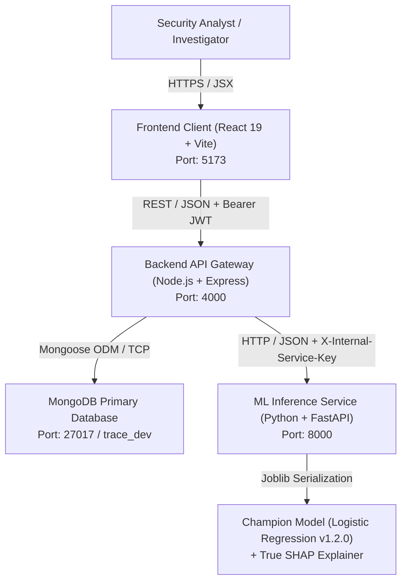

# TRACE — Architecture Overview

TRACE (Transaction Risk & Fraud Analysis Platform) is built on a resilient, microservice-inspired monorepo architecture designed for high-throughput financial fraud scoring, real-time explainability, and immutable human audit compliance.

---

## 1. Multi-Tier System Architecture



---

## 2. Component Communication Patterns

### A. Frontend to Backend (Client Tier)
- **Protocol:** HTTP/1.1 REST with JSON payloads.
- **Authentication:** Standardized `Authorization: Bearer <JWT>` header on all protected routes.
- **State & Refresh:** The frontend Axios instance automatically passes the access token stored in session state. On receiving a `401 TOKEN_EXPIRED`, an interceptor invokes `POST /api/v1/auth/refresh` with the HTTP-only refresh token to obtain a rotated access token without interrupting the user.
- **Base URL:** Configured via `VITE_API_BASE_URL` (default: `http://localhost:4000/api/v1`).

### B. Backend to Database (Persistence Tier)
- **Engine:** MongoDB Community Server (v7.0+) managed via Mongoose 8.x ODM.
- **Connection Resiliency:** In development mode (`NODE_ENV=development`), if standalone MongoDB on port 27017 is unreachable, `backend/src/config/database.js` starts an embedded in-memory database (`mongodb-memory-server`), ensuring seamless developer onboarding.
- **Data Integrity:** Monetary values strictly use `Decimal128` precision. The `AuditLog` collection enforces append-only immutability via pre-hooks blocking updates, modifications, and deletions.

### C. Backend to ML Service (Inference Tier)
- **Protocol:** Internal HTTP communication over dedicated port 8000.
- **Security:** Protected by a shared internal secret key passed in the `X-Internal-Service-Key` header. Direct external calls without this key are rejected with `401 Unauthorized`.
- **Fault Tolerance:** Bounded timeout of 1,500ms (`ML_TIMEOUT_MS`). If the ML microservice is slow or unavailable, the backend degrades gracefully, saving the transaction and flagging it for deferred analysis rather than dropping client requests.

---

## 3. Core Data Flow & Request Lifecycle

```
[ Financial Transaction Ingestion ]
               │
               ▼
   (1) Express Controller validates schema via Zod
               │
               ▼
   (2) Transaction saved to MongoDB (Status: PENDING)
               │
               ▼
   (3) Backend calls Python FastAPI (/internal/v1/predict)
               │
               ├─> Preprocessor scales Time & Amount via RobustScaler
               ├─> Champion Model calculates fraud probability (0.0 - 1.0)
               ├─> Risk Engine scales to Risk Score (0 - 100) & Risk Level
               └─> True SHAP Explainer decomposes feature impacts
               │
               ▼
   (4) Backend persists Prediction entity (linked to Transaction)
               │
               ▼
   (5) If Risk Level >= HIGH (71+ pts):
       Auto-generates FraudAlert (Status: OPEN, Severity: HIGH/CRITICAL)
               │
               ▼
   (6) Audit log entry appended to immutable audit trail
               │
               ▼
   (7) JSON response envelope returned to Client:
       { success: true, data: { transaction, prediction, alert }, meta: { ... } }
```

---

## 4. Subsystem Directory Structure

```
TRACE/
├── frontend/             # Client tier (React 19, Vite, custom financial CSS)
│   ├── src/
│   │   ├── components/   # UI kit (RiskBadge, MetricCard, DataTable, Drawer)
│   │   ├── pages/        # 7 modules (Dashboard, Lab, Explorer, Alerts, etc.)
│   │   └── services/     # Axios API service endpoints
│   └── package.json
│
├── backend/              # Orchestration tier (Express, Mongoose, Zod)
│   ├── src/
│   │   ├── models/       # 9 Mongoose schemas with compound indexes
│   │   ├── controllers/  # Route controllers (Auth, Transaction, Alert, Batch)
│   │   ├── services/     # Business logic & ML HTTP client
│   │   └── middleware/   # JWT auth, RBAC, rate limiter, error envelope
│   ├── tests/            # 50 automated Node.js unit and integration tests
│   └── package.json
│
├── ml-service/           # Machine learning tier (FastAPI, Scikit-learn, SHAP)
│   ├── app/
│   │   ├── core/         # Scaler, trainer, SHAP explainer, model manager
│   │   ├── api/          # Endpoints: /health, /predict, /batch-predict
│   │   └── schemas/      # Pydantic validation schemas
│   ├── models/           # Serialized champion model (.joblib) & metadata
│   ├── tests/            # 14 automated pytest test cases
│   └── requirements.txt
│
└── docs/                 # Architectural specifications, audits & setup guides
```
