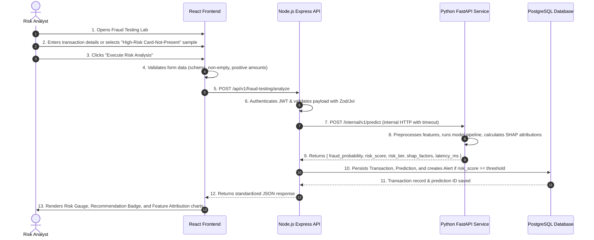
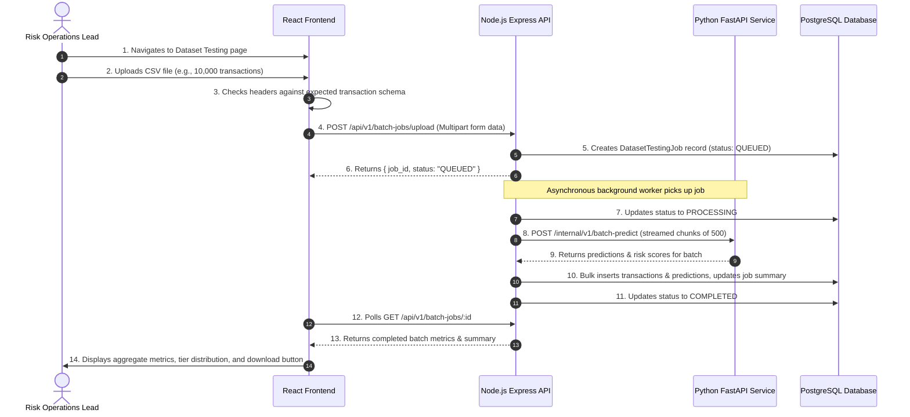
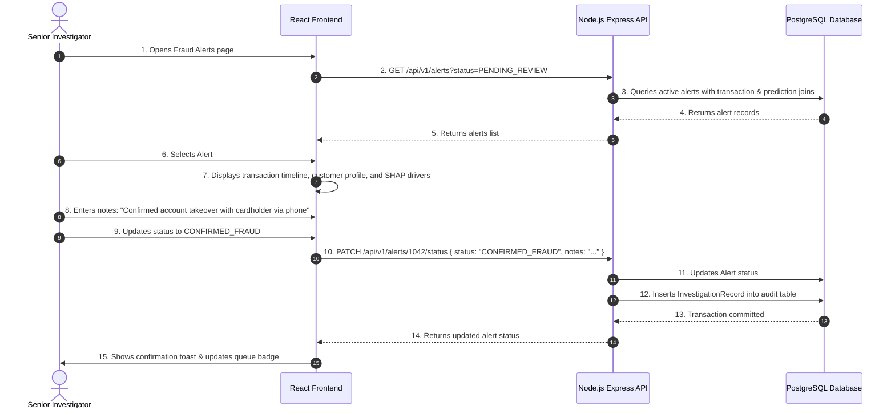

# TRACE — Product Requirements Document (PRD)

**Document Version:** 1.0.0  
**Phase:** Phase 0 — Product Discovery & System Architecture  
**Status:** Approved for Review  
**Product Codename:** TRACE (Transaction Risk & Fraud Analysis Platform)  
**Target Environment:** Node.js (Primary Backend) + Python FastAPI (ML Service) + React (Frontend) + PostgreSQL (Database)

---

## 1. Executive Summary & Product Vision

### 1.1 Mission Statement
**TRACE** is a mission-critical, enterprise-grade Transaction Risk & Fraud Analysis Platform designed for financial institutions, fintech operators, and payment service providers. Its primary purpose is to empower risk analysts, compliance officers, and fraud investigators to evaluate financial transactions in real time, uncover subtle fraudulent patterns, investigate suspicious account behavior, and test transaction portfolios via high-throughput batch analysis.

### 1.2 Core Product Philosophy
Unlike generic dashboards or decorative AI prototypes filled with superficial vanity metrics, TRACE is engineered as a **functional, hardened, audit-compliant financial tool**. It strictly enforces:
- **Zero Hallucination / Zero Synthetic Fluff:** Every metric, risk score, and alert is grounded in real statistical models and deterministic business rules.
- **Explainable Inference:** Predictions must offer feature-level attributions (e.g., via SHAP / TreeExplainer where technically supported) so that analysts can defend decisions before compliance auditors and customers.
- **Clear Demarcation between Model Risk and Confirmed Ground Truth:** A high risk score from a model represents an *estimate of probability*, not a confirmed finding of legal guilt. TRACE enforces a strict workflow separating automated risk triage from human investigation and confirmed dispute resolution.
- **Fintech Ergonomics:** Built for high cognitive clarity, high data density, and long operational shifts without visual fatigue.

---

## 2. User Personas & Role-Based Access Control (RBAC)

TRACE establishes four distinct user roles with hierarchical permissions:

```
[System Administrator]
       └── [Risk Operations Lead]
                 └── [Senior Fraud Investigator]
                           └── [Risk Analyst]
```

### 2.1 Persona Matrix

| Role | Primary Objectives | Typical Workflows | Permitted Actions |
| :--- | :--- | :--- | :--- |
| **Risk Analyst** | Rapid triage of real-time transactions; manual single-transaction testing in the Fraud Testing Lab. | Tests individual transactions, inspects feature attributions, views alert queues, flags items for review. | - Read/Write in Fraud Testing Lab<br>- View Transaction Explorer<br>- View Fraud Alerts<br>- Add notes & change alert status to `UNDER_REVIEW` |
| **Senior Fraud Investigator** | In-depth case investigation, customer outreach review, fraud confirmation, and false-positive resolution. | Investigates escalations, reviews alert histories, updates case disposition (e.g. `CONFIRMED_FRAUD`, `FALSE_POSITIVE`). | - All Analyst permissions<br>- Update alert status to `CONFIRMED_FRAUD` / `FALSE_POSITIVE`<br>- Add formal investigation findings<br>- Export audit reports |
| **Risk Operations Lead** | Portfolio risk oversight, batch testing of transaction datasets, model validation monitoring. | Runs batch dataset evaluation jobs, reviews model drift and performance metrics, tunes operational thresholds. | - All Investigator permissions<br>- Execute Batch Dataset Testing jobs<br>- View & compare Model Performance analytics<br>- Modify operational alert thresholds |
| **System Administrator** | User provisioning, service health auditing, API integration keys, infrastructure maintenance. | Manages user accounts, assigns roles, monitors system audit logs, configures system integrations. | - All Lead permissions<br>- User management (CRUD, role assignment)<br>- System configuration & integrations<br>- Full access to Audit Logs |

---

## 3. Core Functional Requirements

### 3.1 Authentication & Account Management
- **FR-AUTH-01:** Secure user authentication using email and password with Argon2/bcrypt hashing.
- **FR-AUTH-02:** Short-lived JSON Web Tokens (Access JWT: 15-minute expiry) paired with securely stored Refresh Tokens (HttpOnly cookie or database-backed: 7-day expiry).
- **FR-AUTH-03:** Enforce strict RBAC middleware across all protected routes on both Node.js and the frontend navigation shell.
- **FR-AUTH-04:** Complete audit logging of all authentication events (login, logout, failed attempts, session revocation).

### 3.2 Overview & Real-Time Risk Monitoring
- **FR-OVR-01:** High-level operational summary displaying key risk indicators: Total Transactions Evaluated, Flagged Alerts Count, Pending Triage Count, Average Risk Score, and False Positive Ratio.
- **FR-OVR-02:** Volume and Risk Breakdown trends over configurable time horizons (Last 24 Hours, 7 Days, 30 Days).
- **FR-OVR-03:** Live Feed of Recent High-Risk Transactions with immediate jump-to-lab or jump-to-investigation actions.
- **FR-OVR-04:** System status indicators confirming connectivity of the Node.js API, PostgreSQL database, and Python ML inference service.

### 3.3 Fraud Testing Lab (Flagship Interactive Feature)
- **FR-LAB-01:** Interactive transaction simulation workbench allowing an analyst to manually populate transaction parameters or load pre-curated benchmark scenarios (e.g., "Legitimate Grocery Purchase", "Rapid Cross-Border High-Value Transfer", "Card-Not-Present Midnight Tech Velocity", "Stolen Card Testing Small Amounts").
- **FR-LAB-02:** Client-side and server-side strict schema validation enforcing required data types, numerical bounds (e.g., `amount > 0`), and format checks.
- **FR-LAB-03:** Instant inference execution dispatching the payload from React -> Node.js -> Python FastAPI -> Scikit-learn/XGBoost.
- **FR-LAB-04:** Multi-dimensional Risk Output:
  - **Risk Score (0 to 100):** Mathematically calibrated risk index.
  - **Risk Tier:** Categorized as `LOW` (0-30), `MEDIUM` (31-70), `HIGH` (71-89), or `CRITICAL` (90-100).
  - **Decision Recommendation:** `APPROVE`, `REVIEW`, or `DECLINE`.
  - **Fraud Probability:** Raw model probability output (e.g., `0.9421`).
  - **Decision Threshold:** Reference cutoff used by the active model (e.g., `0.5000` or tuned threshold `0.3500`).
- **FR-LAB-05:** **Feature Attribution & Prediction Explanation:**
  - Visual ranking of top factors driving the score up (risk escalators) and factors driving the score down (trust stabilizers).
  - Explicit explanation rationale (e.g., "Transaction amount is 4.8 standard deviations above user 30-day baseline").
- **FR-LAB-06:** Persistence toggle: Option to persist the simulated transaction into the historical database or discard it as an ephemeral test.

### 3.4 Transaction Explorer & Ledger
- **FR-TRX-01:** Comprehensive tabular ledger of all processed transactions with paginated server-side queries.
- **FR-TRX-02:** Multi-faceted filtering: Date range, Amount range, Risk Tier (`LOW`, `MEDIUM`, `HIGH`, `CRITICAL`), Status (`APPROVED`, `FLAGGED`, `REJECTED`, `UNDER_REVIEW`), and Merchant Category.
- **FR-TRX-03:** Search by Transaction ID, Customer ID, Card Fingerprint, or Merchant ID.
- **FR-TRX-04:** Transaction Detail Drawer / Modal displaying complete raw JSON attributes, calculated features, model version used, inference latency, and linked alert history.

### 3.5 Fraud Alerts & Investigation Case Management
- **FR-ALT-01:** Automated alert generation triggered whenever a transaction's risk score exceeds the configured operational alert threshold or violates a critical security rule.
- **FR-ALT-02:** Alert Queue with priority sorting based on severity, transaction value, and queue aging.
- **FR-ALT-03:** Case Assignment workflow allowing leads to assign alerts to specific investigators.
- **FR-ALT-04:** Formal Investigation Disposition states:
  - `PENDING_REVIEW` (Default state on creation)
  - `UNDER_INVESTIGATION` (Analyst actively reviewing)
  - `CONFIRMED_FRAUD` (Human-confirmed malicious activity)
  - `FALSE_POSITIVE` (Legitimate customer transaction cleared)
  - `DISMISSED` (Operational noise or synthetic test discard)
- **FR-ALT-05:** Immutable Investigation Audit Trail recording timestamp, investigator user ID, action taken, prior state, new state, and rationale notes.

### 3.6 Batch Dataset Testing (Portfolio Stress Testing)
- **FR-BAT-01:** Upload facility supporting CSV and JSON datasets containing historical or external transaction batches (up to 50,000 records per job).
- **FR-BAT-02:** Client-side header and schema validation prior to upload, highlighting missing columns or corrupted rows.
- **FR-BAT-03:** Asynchronous job processing with progress tracking (`QUEUED`, `PROCESSING`, `COMPLETED`, `FAILED`).
- **FR-BAT-04:** Batch Analytics Report:
  - Aggregate statistics: Total records evaluated, flagged fraud count, estimated fraud dollar volume.
  - Risk Distribution histogram across the 4 risk tiers.
  - Downloadable CSV of processed records enriched with Risk Score, Risk Tier, and Prediction Flags.

### 3.7 Model Performance & Risk Analytics
- **FR-MDL-01:** Display active model metadata: Model algorithm name (e.g., `RandomForestClassifier`, `XGBClassifier`), training date, artifact hash, and active decision threshold.
- **FR-MDL-02:** Comprehensive evaluation metric reports computed on validation/test holdout sets:
  - Precision, Recall, F1-Score, ROC-AUC, PR-AUC.
  - Full Confusion Matrix (True Negatives, False Positives, False Negatives, True Positives).
- **FR-MDL-03:** Visual Precision-Recall Curve and ROC Curve with marker indicating current operational threshold.
- **FR-MDL-04:** Global Feature Importance ranking across the entire trained model.

### 3.8 System Settings & Configuration
- **FR-SET-01:** Threshold Calibration slider allowing Risk Leads to adjust the operational review threshold (e.g., shifting cutoff from 0.50 to 0.40 to capture higher recall).
- **FR-SET-02:** Service health monitoring (Node.js backend, Python inference service, PostgreSQL connection pool).
- **FR-SET-03:** User profile management (password update, personal notification preferences).

---

## 4. End-to-End User Workflows

### 4.1 Workflow 1: Single Transaction Testing (Fraud Testing Lab)


### 4.2 Workflow 2: Batch Dataset Testing


### 4.3 Workflow 3: Fraud Alert Investigation & Disposition


---

## 5. Non-Functional Requirements (NFRs)

### 5.1 Performance & Latency SLAs
- **NFR-PERF-01 (Single Inference Latency):** End-to-end round-trip latency for single transaction analysis (React -> Node -> Python ML -> PostgreSQL -> React) must not exceed **300ms** at the 95th percentile (p95), with Python inference consuming < **80ms**.
- **NFR-PERF-02 (Batch Throughput):** The batch processing subsystem must evaluate at least **500 transactions per second** on standard multi-core hardware.
- **NFR-PERF-03 (UI Responsiveness):** Initial page loads and client-side view transitions must complete in < **100ms** without layout shifts (CLS < 0.05).

### 5.2 Reliability & Fault Tolerance
- **NFR-REL-01 (Graceful Degradation):** If the Python ML service is temporarily unreachable or experiences timeout, the Node.js backend must return a standardized `503 Service Unavailable` with specific error diagnostics, and the frontend must display an actionable connection banner without crashing.
- **NFR-REL-02 (Database Transactions):** All state changes involving multi-table modifications (e.g., updating alert status and writing to investigation audit logs) must execute inside atomic PostgreSQL transactions.

### 5.3 Security & Compliance
- **NFR-SEC-01 (Data Sanitization & PCI-DSS Awareness):** Raw primary account numbers (PANs) or sensitive card security codes must never be stored in plain text. TRACE uses card tokens and masked representations (e.g., `**** **** **** 4821`).
- **NFR-SEC-02 (Input Validation & Injection Defense):** All incoming parameters are validated through strict whitelist schemas (Zod on Node.js, Pydantic on Python) to prevent SQL injection, NoSQL injection, and XSS attacks.
- **NFR-SEC-03 (Audit Integrity):** Audit records (`AuditLog`, `InvestigationRecord`) are append-only; update and delete operations are strictly prohibited at the database permissions level.

---

## 6. Distinguishing Model Risk vs. Confirmed Fraud

A fundamental failure mode of immature risk platforms is confusing an algorithmic risk score with confirmed financial fraud. TRACE formally separates these concepts across the system architecture:

```
[ Financial Transaction Ingestion ]
                 │
                 ▼
[ Machine Learning Risk Engine ]
                 │
                 ├── Computes: Estimated Fraud Probability (0.0000 - 1.0000)
                 ├── Translates: Risk Score (0 - 100)
                 └── Assigns: Operational Risk Tier (Low / Medium / High / Critical)
                 │
                 ▼
   Is Risk Score >= Alert Threshold?
       ├── NO  ──> Status: APPROVED (No alert generated)
       └── YES ──> Status: FLAGGED (Automated Alert Created)
                         │
                         ▼
             [ Human Investigation Queue ]
                         │
                         ├── Review Evidence & Customer History
                         ├── Contact Customer / Issue Verification
                         │
                         ▼
             [ Human Decision / Ground Truth ]
                         ├── Outcome A: CONFIRMED_FRAUD (Verified illicit activity)
                         └── Outcome B: FALSE_POSITIVE (Legitimate customer cleared)
```

1. **Estimated Risk (Statistical Probability):** Generated in milliseconds by the mathematical model. It reflects statistical anomaly likelihood based on past historical patterns.
2. **Confirmed Fraud (Ground Truth):** Determined solely by human investigator review, chargeback notifications, or verified bank dispute filings.
3. **Prevention of Feedback Loops:** Models must *never* be retrained directly on automated `FLAGGED` transactions without human ground-truth verification, as this induces catastrophic model drift and confirmation bias.
